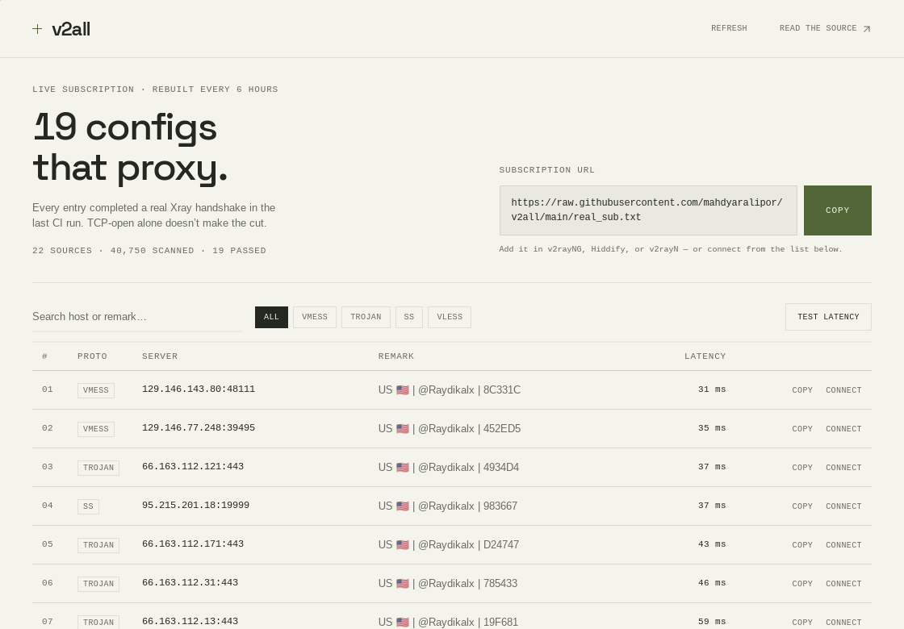

# v2all desktop



Tauri 2 + React. Same design tokens as the landing (`landing/src/index.css`),
same subscription, one extra thing: it can connect.

## What it does

- Reads `docs/data.json` from the published Pages site (cached on disk, so the
  list still opens offline).
- **Test latency** opens a TCP connection to every visible config from this
  machine, not from CI.
- **Connect** parses the share link, writes an Xray config, starts Xray with
  local SOCKS `127.0.0.1:10808` and HTTP `127.0.0.1:10809`, verifies that a
  request actually travels through it, then switches the system proxy.
  Windows: WinINet registry + refresh. Linux: GNOME `gsettings` (other desktops
  keep the tunnel and are told the two ports).
- Disconnect, closing the window, or a crashed Xray restores the previous proxy
  settings and kills the process.

The Xray core is downloaded once from the official `XTLS/Xray-core` release
into the app data directory (`~/.local/share/com.mahdyaralipor.v2all` on Linux,
`%APPDATA%` on Windows) and reused after that.

## Develop

```bash
npm install
npm run tauri dev
```

Linux needs the Tauri system packages:

```bash
sudo apt-get install libwebkit2gtk-4.1-dev libayatana-appindicator3-dev \
  librsvg2-dev libxdo-dev patchelf
```

## Build

```bash
npm run tauri build -- --bundles deb   # Linux
npm run tauri build -- --bundles nsis  # Windows
```

Artifacts land in `src-tauri/target/release/bundle/`. CI builds both on every
push that touches `app/` (`.github/workflows/app.yml`).

## Tests

```bash
cargo test --manifest-path src-tauri/Cargo.toml
```

The suite parses every link currently published in `docs/data.json`, so a new
protocol shape shows up as a failing test instead of a broken Connect button.

One ignored test does the real thing — downloads Xray, starts a local VLESS node
next to the app's client config, then fetches `generate_204` through the SOCKS
port. It proves the full path (link → config → Xray → SOCKS → TLS → internet)
without depending on a free server still being alive:

```bash
cargo test --manifest-path src-tauri/Cargo.toml -- --ignored live_round_trip
```

## Icons

`app-icon.png` is generated from `icon.svg`; regenerate the platform set with
`npx tauri icon app-icon.png`.
